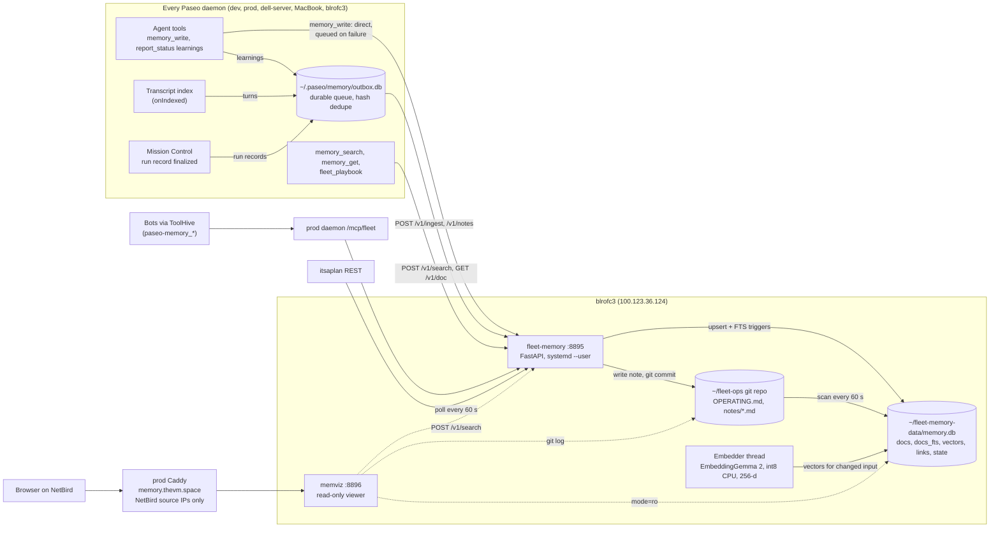

# Fleet memory

Fleet memory is what `memory_search`, `memory_get`, `memory_write` and `fleet_playbook` read and write: one index over every host's agent conversations, run records, itsaplan tickets and the notes vault. It is a separate Python service, `fleet-memory`, not part of the daemon. The daemon only pushes to it and proxies the tools. You can browse it at https://memory.thevm.space (NetBird only), which also serves this page.

## Where it lives

| What           | Where                                                                                                                                         |
| -------------- | --------------------------------------------------------------------------------------------------------------------------------------------- |
| Service source | `/data/projects/fleet-memory` on dev (git, no remote). Deployed as a copy to `blrofc3:~/fleet-memory` with its own `.venv`.                   |
| Service        | `fleet-memory.service`, a systemd `--user` unit on blrofc3, bound to `100.123.36.124:8895` (the NetBird IP). Config in `~/fleet-memory/.env`. |
| Database       | `blrofc3:~/fleet-memory-data/memory.db`, SQLite in WAL mode.                                                                                  |
| Notes vault    | `blrofc3:~/fleet-ops`, a git repo you can open as an Obsidian vault.                                                                          |
| Daemon side    | `packages/server/src/server/memory/` (client, outbox, turn builder) and `packages/server/src/server/agent/tools/memory-tools.ts`.             |
| Pointer        | `memory.url` in each host's `~/.paseo/config.json`, re-read every 30 s. Every host points at `http://100.123.36.124:8895`.                    |
| Viewer         | `scripts/memviz/` in this repo, deployed to `blrofc3:~/memviz`. See [The viewer](#the-viewer).                                                |

## Schema

Everything is a row in `docs`, keyed by a stable `id`:

| Kind             | Id                             | Comes from                                                                                                                                                                       |
| ---------------- | ------------------------------ | -------------------------------------------------------------------------------------------------------------------------------------------------------------------------------- |
| `turn`           | `turn:<agentId>:<ord>:<piece>` | One user prompt plus the agent's text replies. Tool calls and reasoning are left out. Turns longer than 6,000 characters are split into pieces that each repeat the prompt head. |
| `run`            | `run:<agentId>:<runEpoch>`     | Mission Control run record: brief, reports, verdict, proofs.                                                                                                                     |
| `ticket`         | `ticket:<KEY-N>`               | itsaplan ticket title, status, assignee, description.                                                                                                                            |
| `ticket_comment` | `ticket:<KEY-N>:comment:<id>`  | One itsaplan comment.                                                                                                                                                            |
| `note`           | `note:<slug>`                  | `fleet-ops/notes/<slug>.md`.                                                                                                                                                     |
| `doc`            | `doc:operating`, `doc:<path>`  | `OPERATING.md` and other vault pages outside `notes/`.                                                                                                                           |

Columns: `kind, title, text, host, agent_id, project, ticket, url, ts, meta` (JSON), plus `hash` (whole document), `input_hash` (the text the embedder sees) and `embedded_hash` (the input its vector was made from).

Other tables:

- `docs_fts`: FTS5 over `title` and `text` (`unicode61 remove_diacritics 2`), kept in sync by triggers in the same transaction as the write.
- `docs_vocab`: `fts5vocab` over `docs_fts`, used for typo correction.
- `vectors`: `rowid → float32[256]` blob.
- `links`: `[[Title]]` edges between vault pages (`src`, `dst`). A link to a page that does not exist yet points at `note:<slug>`.
- `state`: vault file mtimes, ticket `updatedAt` cursors, `embed_format`.

Who wrote a note lives in its frontmatter (`source:` the agent name, or the MCP client name for bots, plus `created:`), in `## Update <time> (<who>)` sections appended by later writes, and in the vault's git log (`created note: <title> (by <who>)`). Turns and run records carry `meta.agent_name`.

Every write runs `store.redact`, which replaces credential shapes (provider keys, GitHub, Slack, AWS, Cursor and itsaplan tokens, bearer headers) with `[redacted]`. Text is capped at 200,000 characters and titles at 500.

## Write paths

All writes are upserts by id. An unchanged document is skipped, so every sender can retry freely.

1. **`memory_write`** (agent's own daemon): `MemoryService.writeNote` posts to `/v1/notes` directly. If fleet-memory is unreachable the note is queued in the outbox. The daemon fills `source` (agent id, agent name, host); the caller cannot.
2. **`report_status` learnings**: each learning is queued as a note (`kind` defaults to `learning`, `about.agent` is the caller), so the report never waits on memory.
3. **Bots through ToolHive** (`paseo-memory_write`): the call reaches prod's daemon at `/mcp/fleet`, which runs the same tool with no calling agent. The note records only the MCP client name and prod as the host.
4. **Transcripts**: each daemon's transcript search index calls `onIndexed`; `buildTurnItems` turns the chunks into `turn` items and queues them. Mission Control and History Ask agents are skipped.
5. **Run records**: `onRunRecordFinalized` queues a `run` item.
6. **Initial backfill**: the first time a host has `memory.url`, it offers its whole indexed history and every run record once (retried every 5 minutes until it lands). `scripts/backfill.py` in fleet-memory does the same by hand from any host.
7. **Tickets**: fleet-memory polls the itsaplan REST API every 60 s and re-reads a ticket only when its `updatedAt` moved. A board deleted in itsaplan has its tickets removed, the only delete in the system.
8. **Vault edits**: every 60 s fleet-memory re-indexes any `*.md` in `~/fleet-ops` whose mtime changed and rebuilds its links. Hand or Obsidian edits on blrofc3 land this way. `vault.pull()` would also pull and push a git remote, but the vault has none today.

`/v1/notes` writes the Markdown file, auto-links the first plain mention of every existing page title, commits it to the vault repo, and indexes it in one locked step. A second write with the same title appends an `## Update` section instead of replacing the note.

The outbox (`~/.paseo/memory/outbox.db` on each host) holds queued items and notes. Notes flush before items, in batches of 200; a failed flush backs off from 15 s doubling to 10 minutes and survives daemon restarts. The `sent` table remembers the hash of every delivered item, so re-indexing a transcript queues only turns that changed.

## Embeddings

- Model: `google/embeddinggemma-2` through sentence-transformers, truncated to 256 dimensions, normalized.
- Runs on the CPU only: the text tower, int8 weight-only (torchao), 8 threads, `CUDA_VISIBLE_DEVICES` empty, `Nice=5`. The audio and vision towers are dropped at load.
- Document input is `title: <title> | text: <first 6,000 chars>`; queries use the model's `SearchQuery` prompt.
- A background thread embeds, 16 rows at a time, every doc whose `input_hash` differs from its `embedded_hash`. Metadata changes never re-embed. Bumping `EMBED_FORMAT` marks every vector stale; `scripts/reembed.py` rebuilds into a side file and swaps it in while search keeps serving.
- Search loads all vectors into one in-memory matrix (reloaded after new embeddings) and does a brute-force cosine top-k. If the model fails to load, search runs full-text only and reports `vectors: false`.

## Read path

`memory_search` posts `{query, kinds, project, agent, ticket, since, limit, group_by_agent}` to `/v1/search` (default limit 8; the service caps at 50). The tool has no `host` filter, although the service accepts one. Ranking (`fleet_memory/app.py`):

1. **Full text**: BM25 with the title weighted 3×. First every word must match (the last word as a prefix); when that finds fewer than the pool, any non-stopword may match. A word the index has never seen (5+ letters) is replaced by the closest indexed word within edit distance 2, reported in `notes`. Pool = `max(4 × limit, 40)`.
2. **Meaning**: the query vector's top `3 × pool` neighbours, filtered after the fact.
3. **Fusion**: reciprocal rank, `weight / (60 + rank)`: 2.0 for an all-words hit, 1.2 for an any-word hit, 1.0 for a vector hit. A note or doc that already matched on text also gets its true global vector rank when its similarity is within 0.06 of the best hit.
4. **Boosts**: notes ×1.3, docs ×1.6, and up to ×1.5 more when the page's title or tags contain the query's words.
5. `group_by_agent` keeps the best hit per agent.

Each hit's `matched` shows which signals found it (`text:all`, `text:any`, `meaning:0.78`).

`memory_get` reads `/v1/doc/<id>`: the row, its links and backlinks, and a ticket's comments. `fleet_playbook` reads `OPERATING.md` through `/v1/playbook`.

## The viewer

memviz is a read-only web UI over the same data: overview charts, browse and filter (kind, host, project, agent, writer, time), search, item detail with authorship, vault history, links and related items, a notes graph, a meaning map, and this page.

- **Code**: `scripts/memviz/` (`server.py` FastAPI, `index.html`). It started as the viewer the "Fleet memory audit" agent built on the MacBook.
- **Runs**: `memviz.service`, a systemd `--user` unit on blrofc3, from `~/memviz` with its own uv venv, bound to `100.123.36.124:8896`. Survives reboots (linger is on).
- **Deploy**: `scripts/memviz/deploy.sh` from any checkout. It copies the files and this doc (as `architecture.md`), runs `uv sync --frozen`, and restarts only `memviz`. It never touches fleet-memory.
- **Read-only**: it opens `memory.db` with `mode=ro` and `PRAGMA query_only`, reads the vault only through `git log`, and calls only `GET /v1/status` and `POST /v1/search`. Search sends the same body `memory_search` sends, so the hits and order match.
- **Notes graph**: red arrows are `[[links]]`; grey edges join notes that are each other's nearest neighbours above a similarity threshold (mutual k-NN). Plain top-k edges made a hairball, because a few hub notes collected an edge from every note vaguely about them. Unconnected notes are hidden by default.
- **Meaning map**: t-SNE over every note, doc and ticket plus 5,000 random other items, rebuilt every 6 hours on 2 threads at `Nice=10`.

### Exposure

`memory.thevm.space` follows the private `*.thevm.space` pattern (see `guitar.thevm.space` in prod's `/etc/caddy/Caddyfile`):

- Cloudflare DNS-only A record `memory.thevm.space → 100.123.97.105` (prod's NetBird IP), so the name only routes inside NetBird.
- prod's Caddy gets the certificate by DNS-01 and proxies to `100.123.36.124:8896` only for source addresses in `100.64.0.0/10`; everything else is aborted.

Both `:8895` and `:8896` listen on blrofc3's NetBird IP with no auth, so any NetBird peer can reach them directly. fleet-memory's `:8895` accepts writes (`/v1/ingest`, `/v1/notes`) from any peer.
