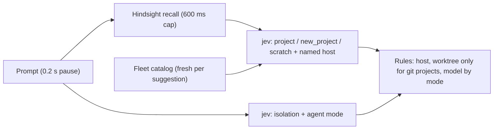

# Placement routing and agent modes

The New workspace screen fills its controls from the prompt: project (or a new project, or the host's scratch area), host, isolation, agent mode, and model. Commander and any other agent get the same answer from the `suggest_placement` MCP tool. One daemon function serves both: `RoutingService.suggest` (`packages/server/src/server/routing/routing-service.ts`). The app receives the model in the config form (`omp:anthropic/…`); `suggest_placement` returns it as `omp/anthropic/…`, the form `fleet_create_agent` takes. Every create path accepts both (`canonicalProviderModel` in `packages/protocol/src/provider-model.ts`).

## How a suggestion is made

- **jev** is TypeSafe's System One judge (`POST https://api.typesafe.ai/v1/systemone`, model `jev-latest`). It only classifies: every question is a `choice` whose criteria are the option descriptions, and it answers with calibrated probabilities in about 0.4 s. It never writes text.
- The **catalog** is the fleet inventory (`buildFleetContextData`): each project's title, description, host, and recent workspace titles. Project descriptions carry most of the signal; a project without one routes badly. Commander's own project and the scratch project are not options. It is loaded fresh for every suggestion, in parallel with the behaviour judge and Hindsight, so it adds no latency. Do not cache it: a cache hides projects added outside routing (Add project, `fleet_create_project`, another host).
- Every question sees the prompt and the optional `routing.rules` text, and its instructions say to follow anything the prompt states explicitly ("on work", "research only", "orchestrate").
- Isolation is `worktree` only for an existing git project. Scratch and new projects run local.
- Host: an existing project fixes it. For a new project or scratch, a host the prompt names wins, else `routing.defaultHost`.

The app fires after a 0.2 s typing pause and drops replies for older prompts; Enter resolves the current prompt immediately when the pause has not passed. A suggestion only fills controls the user has not touched on this screen.

The app always asks the Commander host, never the selected host. A suggestion moves the host selection, and a non-Commander host may have no peers, so it would see only its own projects. Without a designated Commander host, the selected host answers. The catalog fetch asks peers for inventory only (`mission_control.context.fetch` with `inventoryOnly`): the full payload waits on provider discovery, which took 15 s on a freshly booted peer.

The app caches suggestions by prompt plus the fleet's project list, so a project appearing on any host re-runs the suggestion for the current prompt without retyping.

## Naming

| Text                                                                                              | Model                                                                     | When                                                |
| ------------------------------------------------------------------------------------------------- | ------------------------------------------------------------------------- | --------------------------------------------------- |
| New project name, folder slug, first description                                                  | `routing.nameModel` (Groq `qwen/qwen3.8-27b`), `metadataModel` on failure | Once, at Enter: the folder name cannot change later |
| Project description (improved), workspace title, branch rename, agent title, commit and PR drafts | `routing.metadataModel` (Haiku 5.5 through Bifrost)                       | After creation, in the background                   |

Both are plain OpenAI-compatible calls with `reasoning_effort: "none"`. Haiku through omp costs about 5 s of process start; through Bifrost it answers in about 1.2 s. Structured generation (`generateStructuredAgentResponseWithFallback`) tries `metadataModel` first and falls back to the per-host Metadata generation providers. The Groq free tier allows 8,000 tokens per minute, which is why qwen runs once per Enter and never while typing.

## New projects and scratch

`routing.project.create` runs on the target host: `mkdir -p` the configured project root, create the folder, `git init` on `main` with a first commit holding a README, register it as a git project. `fleet_create_project` and Add project → New directory make the same repository (`ensureGitRepository` in `project-directory-service.ts`).

Scratch is one shared plain-directory project per host, titled `experiments`, at `routing.scratchRootByHost` or `~/experiments` when the host has no entry. Every daemon ensures it and its base workspace at boot (`RoutingService.ensureScratchWorkspace`), so a new host has one without anyone routing to it. History Ask agents run in that base workspace (see [history-ask.md](history-ask.md)). The catalog hides it from placement options: by path when the root is configured, else any project rooted at a folder named `experiments`. A scratch `routing.project.create` never renames the project.

## Configuration

All keys live in central Mission Control config (`<paseoHome>/mission-control/central-config.json` on the Commander host, replicated to every peer), edited in Settings → Mission Control → Routing. Hosts are named by serverId.

| Key                                                      | Meaning                                                                                                                                                                 |
| -------------------------------------------------------- | ----------------------------------------------------------------------------------------------------------------------------------------------------------------------- |
| `routing.defaultHost`                                    | Host for new projects and scratch when the prompt names none                                                                                                            |
| `routing.projectRootByHost`, `routing.scratchRootByHost` | Absolute paths per host                                                                                                                                                 |
| `routing.workHosts`                                      | Hosts in the work profile; every other host is personal                                                                                                                 |
| `routing.modelByMode`, `routing.workModelByMode`         | Agent model per mode as `provider:model`; `default` covers unlisted modes. The Settings picker offers only models every host has ticked                                 |
| `routing.nameModel`, `routing.metadataModel`             | `{ baseUrl, model }`                                                                                                                                                    |
| `routingSecrets`                                         | TypeSafe, name model, and metadata model API keys. Replicated to peers, never sent to a client: responses carry `routingSecretsSet` instead, and a patch merges per key |

Prefer a vault reference to a raw key in `routingSecrets`: a value of the form `aside://<account>/<itemId>` makes each host read the item's password field through `aside-vault` (using `~/.config/aside-vault/recovery.env`) once per daemon run, at startup, keep it in memory, and never write it to disk (`packages/server/src/server/secrets/vault-secret.ts`). A rotated key takes effect on the next daemon restart. The reference replicates to peers safely. The TypeSafe key is item `68a30248e39146d3` in the `iammvaibhav@gmail.com` account.

## Agent modes

An agent mode says how the agent works: Do it yourself (the default for every agent that is not Mission Control machinery), Orchestrator, Plan first, Research, Review, Debug. The list lives in `packages/protocol/src/agent-modes.ts`; the instructions are markdown files in `packages/server/src/server/agent/agent-modes/prompts/`, read on every injection, so an edit applies to the next message.

Modes never enter the system prompt. The daemon prepends `<paseo-mode name="…">…</paseo-mode>` to the next user message whenever the agent's mode differs from the one the provider last received (`AgentManager.withAgentModePrefix`). That keeps the cached system prompt shared across agents and modes, lets the user switch modes mid-chat without starting work (the switch applies at their next message), and reaches ACP providers, which have no system prompt. Machinery envelopes and slash commands never carry the block. Clients strip it from the transcript and show a mode label instead.

The global system prompt (`scripts/paseo-system-prompt.md`) carries no delegation policy; the Orchestrator mode file holds it.
